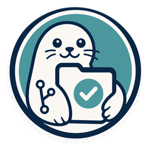

# Signetum

  

**Reliable agentic development and delivery, through one standard Skill.**

Signetum helps a coding agent retain decisions, implement approved changes,
validate the exact source and prepare an inspectable delivery. It works with
new projects and existing repositories, using their own application tools.

## Install and start

Install [`skills/signetum`](https://github.com/R0k1e/Signetum/tree/main/skills/signetum)
with your agent's standard Skill installer. Select an exact reviewed release tag
or commit for reproducibility. Replace an older `repo-dev` Skill explicitly;
installing the new Skill does not update previously adopted repositories.

Then ask:

> Use $signetum to set up this new project, or inspect and adopt this existing
> repository. Preserve its tools and show the proposed changes first.

The agent obtains a fixed-version setup tool, inspects the project and prepares
minimal local bindings. You review the preview. After adoption, the Skill calls
the repository's local runtime; normal development needs neither an upstream
checkout nor repeated tool downloads. See [First use](QUICKSTART.md).

For a development task, describe the behavior normally. The agent proposes the
outcome and acceptance, keeps significant reasoning once, implements the change
and reports the exact source that passed readiness. Delivery remains explicit.

## What it gives you

- One change record, significant append history and a derived current decision set.
- Behavioral validation through existing application commands; optional selection
  and scheduling preserve full final validation and original failures.
- Isolated member workspaces and an explicit shared delivery boundary.
- Reviewable evidence connecting recorded requirements, checked source and delivery.

The runtime is language-neutral and uses a host Python interpreter. It can retain
Python, Node, Rust or other application runners. It provides no remote ledger,
automatic consumer update or proof that software is defect-free.

## Maintained source

`main` owns the Skill, setup/runtime implementation and documentation. The
`template/` directory is internal scaffolding and runtime test material, not a
second installation route or independently published product. The package bundles
the same standard Skill folder; there is one source and release path.

[Documentation](docs/README.md) covers usage and configuration.
[Architecture](docs/ARCHITECTURE.md), [Contributing](CONTRIBUTING.md) and
[releasing](docs/maintainers/releasing.md) describe maintenance.
[Security](SECURITY.md) · [Changelog](CHANGELOG.md) · [Apache-2.0](LICENSE)
